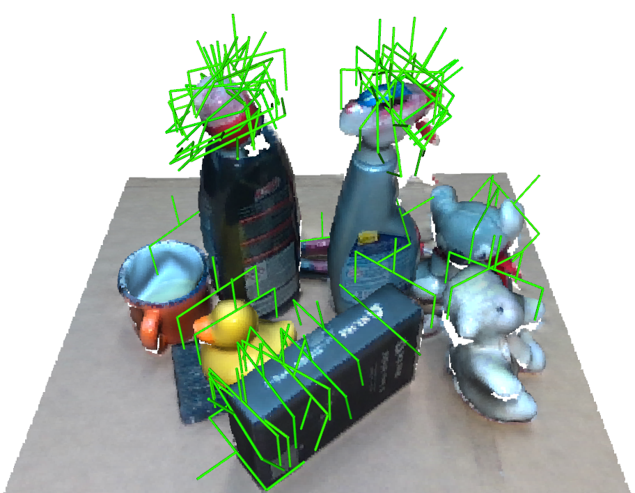
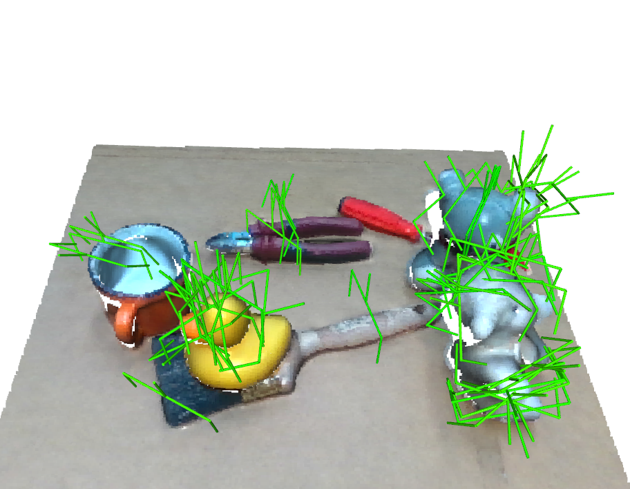

# Continual Learning for 6-DoF Grasp Synthesis via Experience and Demonstrations

This repository is the top-level benchmark and reproduction code for our CoRL
2026 paper. It combines the simulation environment, grasp-detection and
continual-learning models, and real-robot deployment stack as Git submodules,
and provides the integrated scripts used to collect data, train models, adapt
policies, and evaluate them in simulation or on a Franka Emika Panda.

<table>
  <tr>
    <td width="50%"></td>
    <td width="50%"></td>
  </tr>
  <tr>
    <td colspan="2" align="center">
      <sub>
        Grasp proposals generated from single-view point clouds of real-world
        scenes captured with an Intel RealSense D435 and reconstructed using
        <a href="https://github.com/NVlabs/Fast-FoundationStereo">Fast-FoundationStereo</a>.
        See
        <a href="https://github.com/giuschio/realsense-utils-public">RealSense Utilities</a>
        for point-cloud reconstruction and
        <a href="https://github.com/giuschio/simple-panda-grasp-public">Simple Panda Grasp</a>
        for robot deployment.
      </sub>
    </td>
  </tr>
</table>

## Associated paper and code

> **Continual Learning for 6-DoF Grasp Synthesis via Experience and
> Demonstrations** \
> Giulio Schiavi, Andrei Cramariuc, Michael Pantic, and Roland Siegwart
>
> [Paper](https://arxiv.org/abs/2610.01301) |
> [Project page](https://giuschio.github.io/cl_grasping/)

The paper code is split into reusable repositories:

- **[Simulation environment](https://github.com/giuschio/grasp-env-public):**
  scene generation, data collection, and simulated grasp evaluation.
- **[Grasp detection model](https://github.com/giuschio/graspcl-model-public):**
  model training, grasp inference, recall, and continual adaptation.
- **[Robot control and deployment](https://github.com/giuschio/simple-panda-grasp-public):**
  camera calibration, real-world perception, reachability checks, and grasp
  execution.
- **[Paper benchmark](https://github.com/giuschio/graspcl-benchmark-public)
  (this repository):** integrated experiment and reproduction scripts.

## Repository layout

```text
graspcl-benchmark-public/
|-- grasp_cl_integration/       # shared experiment/runtime glue
|-- scripts_integrated/
|   |-- 0_data_collection/      # simulated dataset collection and inspection
|   |-- 1_train/                # encoder training and CL-module creation
|   |-- 2_eval/                 # adaptation and simulation/robot evaluation
|   `-- utilities/              # experiment setup, summaries, and visualization
`-- submodules/
    |-- grasp_env/              # simulation environment
    |-- grasp_learning_cl/      # grasp model and continual learning
    `-- simple_panda_grasp/     # real-robot deployment
```

The scripts are runnable entry points. Shared code that connects the three
components lives in `grasp_cl_integration`.

## Clone and install

Python 3.10 or newer is required. Clone recursively so all three components and
the robot stack's nested dependencies are available:

```bash
git clone --recurse-submodules \
  https://github.com/giuschio/graspcl-benchmark-public.git
cd graspcl-benchmark-public
```

If the repository was cloned without submodules, initialize them with:

```bash
git submodule update --init --recursive
```

For the simulation and learning workflow, install PyTorch for the machine
first, then install the component packages and benchmark glue in editable mode:

```bash
python -m pip install torch pytorch-lightning torch-geometric omegaconf tqdm
python -m pip install -e submodules/grasp_env
python -m pip install -e submodules/grasp_learning_cl
python -m pip install -e .
```

The simulator also needs object datasets that cannot be redistributed here.
Follow the [grasp environment asset instructions](https://github.com/giuschio/grasp-env-public#assets)
before collecting data or running simulated evaluations.

Real-robot experiments additionally require the Panda/RealSense stack. Follow
the [Simple Panda Grasp installation and calibration instructions](https://github.com/giuschio/simple-panda-grasp-public#installation),
then install it in this checkout:

```bash
python -m pip install -e submodules/simple_panda_grasp
```

The robot code controls physical hardware. Review all configured poses, keep
the workspace clear, and be ready to stop the robot before running it.

## Machine configuration

Evaluation and adaptation scripts read the tracked `machine_config.yaml` in the
repository root. It defaults to simulation:

```yaml
machine_type: simulation
```

For real-robot execution, edit it to point to the configuration produced by the
Simple Panda Grasp calibration procedure:

```yaml
machine_type: real_robot
panda_config_path: submodules/simple_panda_grasp/configs/config_panda.yaml
```

## Reproduction workflow

Run commands from the repository root. Each script exposes its complete set of
options through `--help`; the examples below show the main stages.

### 1. Collect simulated training data

```bash
python scripts_integrated/0_data_collection/collect_training_data_from_sim.py \
  --output_dir data/training_data
```

Dataset statistics and visualization helpers are under
`scripts_integrated/0_data_collection/utils/`.

### 2. Train the encoder

Train the reconstruction autoencoder first:

```bash
python scripts_integrated/1_train/train_encoder.py \
  --model_type pure_autoencoder \
  --dataset_root data/training_data \
  --output_dir data/models/embeddings
```

Then initialize and train the supervised soft-nearest-neighbor encoder from
that checkpoint:

```bash
python scripts_integrated/1_train/train_encoder.py \
  --model_type snn_autoencoder \
  --dataset_root data/training_data \
  --output_dir data/models/embeddings \
  --load_initial_weights /path/to/pure_autoencoder/checkpoints/best.ckpt
```

### 3. Build a continual-learning module

```bash
python scripts_integrated/1_train/make_cl_module.py \
  --encoder_path /path/to/snn_autoencoder/checkpoints/best.ckpt \
  --training_data_path data/training_data \
  --output_path data/grasping_models/grasp-model
```

This packages the encoder with the probabilistic scoring memory and recall
state used for inference and online adaptation.

### 4. Evaluate and adapt

Evaluate a module reproducibly in simulation:

```bash
python scripts_integrated/2_eval/eval_sim_reproducible.py \
  --cl_module_path data/grasping_models/grasp-model \
  --output_path data/experiments/base \
  --eval_object_set category-example
```

Adapt it using grasp outcomes and optional demonstrations:

```bash
python scripts_integrated/2_eval/adaptation.py \
  --cl_module_source_path data/grasping_models/grasp-model \
  --experiment_path data/grasping_models/adapted \
  --train_object_set category-example
```

The corresponding real-robot entry points are
`scripts_integrated/2_eval/eval_real_reproducible.py` and
`scripts_integrated/2_eval/deploy_real.py`. Utilities for preparing reproducible
real scenes and summarizing their logs live in `scripts_integrated/utilities/`.

## Citation

If you use this benchmark or its components in your research, please cite:

```bibtex
@misc{schiavi2026continuallearning6dofgrasp,
  title         = {Continual Learning for 6-DoF Grasp Synthesis via Experience and Demonstrations},
  author        = {Giulio Schiavi and Andrei Cramariuc and Michael Pantic and Roland Siegwart},
  year          = {2026},
  eprint        = {2610.01301},
  archivePrefix = {arXiv},
  primaryClass  = {cs.RO},
  url           = {https://arxiv.org/abs/2610.01301}
}
```
